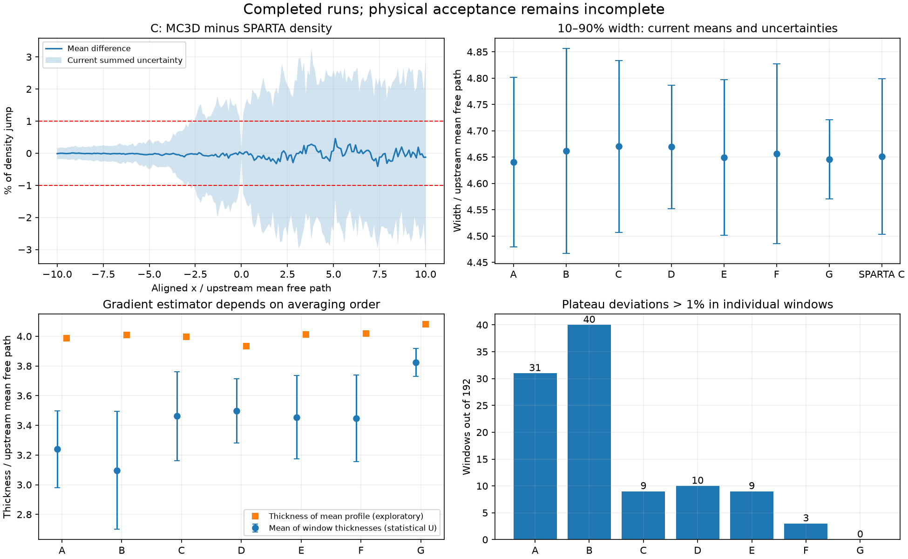

# Разбор приёмки ударной волны, 7 ноября 2026

Все 21 расчёт MC3D и 9 расчётов SPARTA завершились успешно. Серия заняла
123,1 минуты, обработчик не зарегистрировал ошибок анализа. Однако критерии
стационарности, сходимости и согласия кодов не подтверждены. Статус этапа 9b
остаётся `incomplete`; успешное выполнение расчётов не означает приёмку модели.

Исходная локальная серия: `output/shock-validation-restart/series`.
Этот аудит не изменяет её файлы, допуски или итоговый отчёт. Хеш отчёта, бинарников
и использованных файлов профилей записан в `acceptance-audit.json`.



## Что блокирует приёмку

Проверка эквивалентности требует одновременно `U ≤ tolerance/2` и
`|difference| + U ≤ tolerance`. Ниже U — именно оценка, которую сейчас использует
обработчик, а не заново рассчитанный доверительный интервал.

Для MC3D C против SPARTA C:

| Метрика | Разница средних | U | Допуск | Максимально разрешённая U |
|---|---:|---:|---:|---:|
| Нормированная плотность, максимум по сетке | 0,004570 | 0,029937 | 0,010000 | 0,005000 |
| Ширина 10–90%, в λ₁ | 0,019177 | 0,310949 | 0,139533 | 0,069767 |
| Градиентная толщина, в λ₁ | 0,054262 | 5,779896 | 0,102217 | 0,051109 |

Максимумы разницы и U для плотности могут достигаться в разных точках.
Все 201 средних значений плотности находятся внутри допуска, но 137 точек
не проходят ограничение на U. Средняя ширина — 4,670292 у MC3D и 4,651115
у SPARTA: расхождение 0,41%. Близость средних не заменяет требуемую точность.

Во всех шести сравнениях сетки/статистики/шага/области максимальное расхождение
средней нормированной плотности меньше 0,005, различие ширин меньше 0,025 λ₁.
Однако для градиентной толщины в A–B, B–C и G–C сами различия средних превышают
допуск. Поэтому нельзя свести все непрохождения исключительно к большим U.

## Стационарность

Фронт достаточно далеко от границ во всех 1344 окнах MC3D: минимум около
19,49 λ₁ при требовании 10 λ₁ (в расширенной области F — около 39,61 λ₁).
Эта часть критерия выполнена.

| Вариант | Окон с отклонением плато >1% из 192 | Максимум отклонения |
|---|---:|---:|
| A | 31 | 2,274% |
| B | 40 | 2,179% |
| C | 9 | 1,395% |
| D | 10 | 1,373% |
| E | 9 | 1,905% |
| F | 3 | 1,109% |
| G | 0 | 0,702% |

Текущий код требует прохождения каждого короткого окна, а не оценки среднего
плато с неопределённостью. При усреднении всех окон каждого seed максимальный
модуль знакового отклонения плато составляет около 0,20% скачка плотности.
Это согласуется с влиянием флуктуаций на оконный критерий, но само по себе
не доказывает стационарность: нужно проверить временные ряды и корреляции.

Все 42 сравнения первой и второй половины по двум толщинам не проходят
ограничение на U. Для C разница половин по ширине составляет 0,00057–0,03958 λ₁,
а сумма U — 0,17027–0,36476 при допуске 0,14011 и пределе U 0,07005.
Даже G, где все плато проходят, не подтверждает стационарность по этому правилу.

## Оценка неопределённости и обработка

Обработчик берёт максимум между разбросом средних трёх seed и интервальными
оценками блоков длительностью τ и 2τ внутри каждого отдельного seed. Для ширины
C получаются соответственно 0,03416 и максимум 0,16315 λ₁. Это намеренно
консервативная схема; по этим данным нельзя просто убрать максимум, принять
шаги за независимые образцы или уменьшить U в √3 раза.

Коэффициент Стьюдента 4,303 используется для любого числа блоков ≥3. Для трёх
seed это соответствует df=2, а для большего числа независимых блоков он
консервативен. Но независимость блоков здесь ещё не доказана; замена коэффициента
сама по себе не решает задачу приёмки.

Градиентная толщина рассчитывается как обратный максимальный градиент отдельно
в каждом коротком окне, затем усредняется. Поиск максимума чувствителен к шуму.
В U обработки попадает наибольшее расхождение сглаживаний 1 λ₁ и 0,5 λ₁
среди всех окон и seed, а не чувствительность того же итогового среднего.
В сравнении C со SPARTA это даёт 5,20335 λ₁ из суммарных 5,77990 λ₁.

Диагностический эксперимент: совместить фронты, усреднить плотность, затем
измерить толщину. Для MC3D C получаются 3,99601 вместо 3,46150 λ₁; чувствительность
к ширине обработки — 0,12118 вместо максимума 2,52831 λ₁. Для A–G такой
диагностический результат лежит в диапазоне 3,93284–4,07998 λ₁, тогда как
исходные средние оконных толщин — 3,09663–3,82503 λ₁.

Это другая измеряемая величина и дополнительная интерполяция. Выравнивание по
шумному фронту также может вносить смещение. Новый результат не является
«исправленным истинным значением» и не подставлен в критерии. Нужна проверка
оценивателя на известных профилях до изменения процедуры приёмки.

## Следующие шаги без повторного расчёта физики

1. Зафиксировать, какую толщину принимаем: стационарного среднего профиля или
   среднюю мгновенную. Проверить выбранный оцениватель на известных гладких
   профилях с разной асимметрией, шумом и случайным смещением фронта. Проверить
   влияние сетки, интерполяции, ширины сглаживания и числа окон.
2. На сохранённых данных построить согласованную оценку U того же оценивателя:
   независимые seed и временные блоки с проверкой корреляции/чувствительности
   к длине блока. Оценивать чувствительность обработки на том же агрегате,
   численную погрешность — отдельно. Не ослаблять допуски для получения passed.
3. Разделить в отчёте изменение средних во времени, точность сравнения половин,
   среднее плато и отдельные оконные выбросы. Любое изменение критерия документировать
   и проверять заранее; исходный вердикт сохранить.
4. Повторить анализ всех уже сохранённых MC3D/SPARTA данных новой версией
   обработчика в отдельном отчёте. Лишь после этого выбирать дополнительные
   seed, длительность или число частиц по конкретной недостающей точности.

Сейчас нет основания менять VHS-параметры или повторять всю матрицу вслепую.
Экспериментальная проверка остаётся отдельной незакрытой задачей: исходные
экспериментальные данные ещё не подтверждены.

## Воспроизведение

```sh
python3 tools/audit_shock_validation.py /path/to/series --output /path/to/audit.json
# matplotlib нужен только для графика:
python3 tools/plot_shock_audit.py /path/to/series/validation.json \
  /path/to/audit.json /path/to/audit.png
python3 -m unittest discover -s tests/python
```

Проверены 42 Python-теста, включая соответствие диагностического разложения
исходному критерию и запрет экстраполяции профиля. Новые симуляции не запускались.
