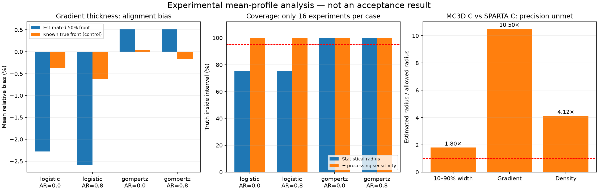

# Проверка оценивателя и повторная обработка, 7 ноября 2026

Проверен кандидат: толщина усреднённого, выровненного профиля вместо среднего
толщин коротких окон. Повторно обработаны все сохранённые 21 результата MC3D
и 9 результатов SPARTA. Новые физические расчёты не запускались.

**Кандидат пока нельзя использовать для положительного решения о приёмке.**
Синтетика выявила смещение градиентной толщины из-за выравнивания по шумному
пересечению уровня 50%. Даже исследовательские оценки неопределённости на
физических данных превышают требования. Исходный `validation.json` не изменён.



## Зафиксированная процедура

- Координата — расстояние от фронта в λ₁. Каждое окно выравнивается по
  монотонному пересечению 50%; затем плотность линейно интерполируется на
  сетку −10…10 λ₁ с шагом 0,05 λ₁ и усредняется по окнам и трём seed.
- Ширина 10–90% определяется по монотонному профилю. Для градиента используется
  локальный кубический полином полной ширины 1 λ₁; 0,5 λ₁ — проверка
  чувствительности обработки **того же усреднённого профиля**.
- Для неопределённости повторно выбираются целые seed и циклические блоки
  из 8/16 последовательных окон. Внутри одного выбора целиком переносится
  профиль, поэтому пространственная зависимость сохраняется. 512 повторов,
  фиксированный генератор `20261107`. Для каждой половины ряда — 256 повторов.
- Радиус интервала — максимум расстояний от оценки до квантилей 2,5% и 97,5%.
  Берётся максимум по длинам блока и консервативной оценке разброса трёх seed
  с коэффициентом 4,303; для нелинейной метрики учитывается также отличие
  среднего seed-метрик от метрики общего среднего.
- Для плотности дополнительно используется 95%-квантиль максимального по всей
  сетке отклонения bootstrap-профиля. Это исследовательская оценка совместного
  разброса, не доказанная 95%-полоса для физического процесса.

Эта процедура оценивает другую величину, чем прежний обработчик. Не доказаны
стационарность рядов, независимость длинных блоков, отсутствие смещения
выравнивания и номинальное покрытие на физических данных. Совместное
перевыбирание seed и блоков плюс консервативный максимум также не является
калиброванным доверительным интервалом. Численная погрешность дискретизации
не заменена статистической U или чувствительностью сглаживания.

## Синтетические проверки

Использованы логистический и асимметричный профиль Гомпертца с аналитически
известными ширинами и максимальными производными. Для масштаба s:
логистический профиль имеет ширину `2 ln(9) s` и градиентную толщину `4s`;
Гомпертц — ширину `ln(ln(0,1)/ln(0,9)) s` и толщину `e s`.

Без шума проверены масштабы 0,25, 1, 2 и шаги сетки 0,05/0,1. Для масштабов
1 и 2 относительная ошибка обеих метрик меньше 0,1%. На узких профилях
масштаба 0,25 ошибка градиента составляет 2,4–7,9%: ширина сглаживания 1 λ₁
их не разрешает в пределах заранее заданного 1%-критерия. Это отрицательный
контроль, не повод ослаблять критерий.

Шумовой тест: 3 seed × 64 окна; стандартное отклонение шума 1,5% скачка;
смещение фронта равномерно в −1…1 λ₁; независимый шум и AR(1) с коэффициентом
0,8. Для каждого из четырёх случаев — 16 независимых экспериментов, 128
bootstrap-повторов внутри каждого. По тем же реализациям выполнен контроль
с **известным истинным фронтом**, недоступный для реальных данных.

| Профиль / AR | Смещение ширины | Смещение градиентной толщины | При известном фронте | Покрытие градиента статистическим интервалом |
|---|---:|---:|---:|---:|
| Логистический / 0 | +0,069% | −2,279% | −0,363% | 12/16 |
| Логистический / 0,8 | +0,187% | −2,594% | −0,615% | 12/16 |
| Гомпертц / 0 | +0,236% | +0,529% | +0,035% | 16/16 |
| Гомпертц / 0,8 | +0,296% | +0,524% | −0,168% | 16/16 |

Для ширины покрытие составило 15/16, 16/16, 16/16 и 16/16 соответственно.
Добавление чувствительности обработки даёт 16/16 для градиента во всех четырёх
случаях, но 16 экспериментов недостаточно, чтобы подтвердить 95%-покрытие.
Это ограниченный набор профилей, не калибровка под распределение шума MC3D.

Контроль с известным фронтом показывает вклад ошибки выравнивания в смещение
оценки. Следующий алгоритмический шаг — устойчивое выравнивание по участку
фронта, а не одной шумной точке, с проверкой на тех же и дополнительных
синтетических профилях. Истинный фронт из контрольного теста нельзя использовать
в реальной процедуре.

## Повторная обработка существующей серии

Все исходные профили/дампы и исходный отчёт идентифицированы хешами в
`mean-profile-reanalysis.json`. В опубликованных отчётах нет абсолютных путей
с локальным логином. Локальные данные находятся в `output/shock-validation-restart/series`.

Для C против SPARTA C, в единицах λ₁ для толщин:

| Величина | MC3D | SPARTA | Разница средних | Исследовательская суммарная U | Предел U по прежнему критерию |
|---|---:|---:|---:|---:|---:|
| Ширина 10–90% | 4,653182 | 4,649248 | 0,003933 | 0,125457 | 0,069739 |
| Градиентная толщина | 3,996013 | 4,002950 | −0,006937 | 0,630391 | 0,060044 |
| Плотность, максимум по сетке | — | — | 0,004570 | 0,020616 | 0,005000 |

Ширины различаются всего на 0,085%, но U всё ещё в 1,80 раза больше разрешённой.
Для градиента U складывается из статистической части 0,350948 и чувствительности
обработки 0,279444 λ₁. Все девять сравнений вариантов/кодов остаются неподтверждёнными
при прежних численных допусках даже в исследовательской процедуре. Значения
`passed` внутри диагностических проверок не являются вердиктом приёмки;
общий статус намеренно `incomplete_experimental_estimator`.

Сравнение половин C тоже не подтверждено: для ширины различие 0,035265 λ₁,
U 0,113254 при пределе 0,070065. Выборочные корреляции соседних окон ширины
для трёх seed C — 0,137, 0,310 и 0,005; это не доказательство независимости
блоков длины 8/16 и не оценка полной корреляционной длины.

## Что делать дальше

1. Проверить устойчивое определение сдвига фронта по нескольким точкам/участку
   профиля. Сохранить контроль с известным фронтом, узкие профили и AR-шум;
   расширить диапазон асимметрии, амплитуд и пространственной корреляции шума.
2. После фиксации оценивателя проверить покрытие на большем числе независимых
   синтетических серий, сходимость bootstrap по числу повторов и длине блоков.
   Выделить смещение оценивателя, статистику, обработку и численную погрешность.
3. Повторить анализ тех же сохранённых данных. Только если оцениватель проходит
   эти проверки, выбирать дополнительные seed/длительность по недостающей
   точности. Сейчас запуск всей матрицы или подстройка VHS не обоснованы.

## Воспроизведение и тесты

```sh
python3 -m venv .venv-analysis
.venv-analysis/bin/python -m pip install -r requirements-analysis.txt
.venv-analysis/bin/python tools/validate_shock_estimator.py --output /path/to/new-calibration.json
.venv-analysis/bin/python tools/reanalyze_shock_mean.py output/shock-validation-restart/series \
  --output /path/to/new-reanalysis.json
# matplotlib нужен только для графика:
python3 tools/plot_shock_estimator.py /path/to/new-calibration.json \
  /path/to/new-reanalysis.json /path/to/figure.png
.venv-analysis/bin/python -m unittest discover -s tests/python
```

Проверены 50 Python-тестов с NumPy, включая аналитические профили, отрицательный
контроль узкого фронта, воспроизводимость выборки и сохранение пространственных
зависимостей при bootstrap. В CI добавлена установка зависимости, чтобы новые
тесты не пропускались. Версия NumPy записана в численных артефактах. Сборка солвера
и физическая модель не менялись.
