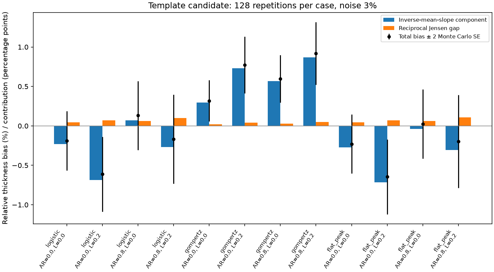

# Gradient-bias decomposition

Diagnostic only: no estimator correction or physical-acceptance change is justified by this experiment alone.

For a positive slope normalized by its analytic value, s, the empirical thickness error splits exactly into:

```text
mean(1/s) - 1 = [1/mean(s) - 1] + [mean(1/s) - 1/mean(s)]
```

The first term is the inverse-mean-slope component; the second is the nonnegative Jensen gap from reciprocal nonlinearity. The first term includes Monte Carlo fluctuation in the measured mean, not just systematic bias. Reported Monte Carlo standard errors describe the precision of these synthetic averages, not physical uncertainty intervals.

Protocol: 128 paired repetitions per case, fresh seeds 2400000–2400127, three seeds × 64 windows, 3% density noise. The same 12 shapes/correlation scenarios as the previous pilot are used. Noiseless translated controls use eight repetitions; direct analytic profiles isolate differentiation on the output grid. Noise-free interpolation/derivative errors are below 0.15% in these controls.

Three paths are compared: exact front and analytic peak; exact front and peak selected on the other two seeds; the existing template-alignment/independent-peak candidate. The exact-front selected-peak path uses the unsmoothed training mean. The template path uses its existing smoothed monotone template, so the difference between these paths cannot be attributed solely to alignment. No exceptions are silently accepted: errors are retained in the JSON, and invalidate a clean diagnostic run.

All values below are percentages (additive contributions in percentage points); ± is one Monte Carlo standard error.

| Shape | AR | Spatial | Known front/peak bias | Selected peak bias | Template candidate bias ± SE | Inverse-mean component | Jensen gap |
|---|---:|---:|---:|---:|---:|---:|---:|
| logistic | 0.0 | 0.0 | -0.098 | +0.628 | -0.188 ± 0.188 | -0.233 | 0.045 |
| logistic | 0.0 | 0.2 | -0.296 | +0.641 | -0.613 ± 0.237 | -0.684 | 0.071 |
| logistic | 0.8 | 0.0 | +0.109 | +0.840 | +0.133 ± 0.218 | +0.072 | 0.060 |
| logistic | 0.8 | 0.2 | +0.114 | +0.870 | -0.168 ± 0.283 | -0.269 | 0.101 |
| gompertz | 0.0 | 0.0 | +0.023 | +0.509 | +0.319 ± 0.131 | +0.297 | 0.022 |
| gompertz | 0.0 | 0.2 | -0.111 | +0.268 | +0.773 ± 0.179 | +0.732 | 0.040 |
| gompertz | 0.8 | 0.0 | +0.166 | +0.696 | +0.597 ± 0.150 | +0.569 | 0.028 |
| gompertz | 0.8 | 0.2 | +0.160 | +0.621 | +0.919 ± 0.199 | +0.869 | 0.050 |
| flat_peak | 0.0 | 0.0 | -0.163 | -0.004 | -0.230 ± 0.187 | -0.274 | 0.044 |
| flat_peak | 0.0 | 0.2 | -0.360 | +0.508 | -0.646 ± 0.236 | -0.717 | 0.071 |
| flat_peak | 0.8 | 0.0 | +0.044 | -0.354 | +0.024 ± 0.220 | -0.037 | 0.061 |
| flat_peak | 0.8 | 0.2 | +0.049 | +0.105 | -0.197 ± 0.294 | -0.307 | 0.109 |



## Interpretation

All 1536 noisy repetitions completed without errors. For the template candidate, the reciprocal Jensen gap is only 0.022–0.109 percentage points; total observed thickness bias ranges from −0.646% to +0.919%. A reciprocal-only correction cannot explain or reliably remove the observed error. No such correction is implemented.

The earlier 32-repeat pilot's uniformly positive +0.83–2.43% bias does not reproduce on this fresh larger batch. The pilot remains a failed screen under its original gates, but its numeric bias must not be treated as a stable calibration constant. Scenarios share random seeds and are correlated; their agreement is not 12 independent confirmations. This decomposition does not retest the pilot's variability gate or qualify the estimator.

Gompertz retains positive template-candidate bias (+0.319–0.919%), while the exact-front/known-peak control is −0.111% to +0.166%. Peak estimation and template preprocessing therefore warrant investigation. The paired exact-front experiment measures the effect of estimating the peak without front uncertainty, but its unsmoothed selection differs from the template candidate; it cannot uniquely identify the candidate's remaining bias.

The next targeted experiment should hold alignment fixed and compare peak selection with and without the existing template smoothing on the same training seeds, recording peak-position error against analytic truth and held-out slope error. Then vary selection smoothing and derivative fit width under a prespecified training/validation split. Do not select a correction on this batch and call it validated. Rebuilding templates and peak selection during resampling, interval-coverage calibration and the separate width 10–90 failures still block physical acceptance.

## Reproduction

```sh
OPENBLAS_NUM_THREADS=1 VECLIB_MAXIMUM_THREADS=1 python tools/decompose_gradient_bias.py \
  --repeats 128 --output output/gradient-bias-decomposition.json
```

Use a new output path; existing files are refused. [Aggregate results](gradient-bias-decomposition.json) include the SHA-256 of the full local artifact, per-method decomposition, noiseless controls and paired peak-selection differences. The full artifact retains each repetition’s normalized slopes. Physical output and original validation reports are untouched.
